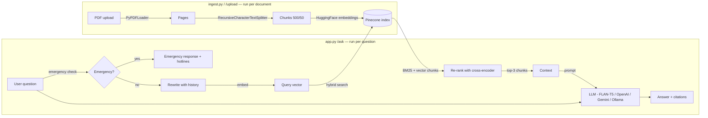

# MedLex — Medical Encyclopedia RAG Chatbot

A Retrieval-Augmented Generation (RAG) chatbot that answers medical questions
*only* from a medical encyclopedia you provide — it retrieves the most
relevant passages first, then asks a small language model to summarize
strictly from that retrieved text, rather than answering from the model's
own parametric knowledge.

Not medical advice. See [Disclaimer](#disclaimer).

## Overview

| | |
|---|---|
| **Ingestion** | `PyPDFLoader` → `RecursiveCharacterTextSplitter` (500 chars / 50 overlap) |
| **Embeddings** | `sentence-transformers/all-MiniLM-L6-v2` via `langchain-huggingface` |
| **Vector DB** | Pinecone (serverless) + BM25 hybrid search |
| **Re-ranking** | `cross-encoder/ms-marco-MiniLM-L-6-v2` cross-encoder |
| **Generation** | Multi-provider: FLAN-T5 (local) / OpenAI / Gemini / Ollama |
| **API** | Flask (`/ask`, `/ask/stream`, `/upload`, `/feedback`, `/history`) |
| **Frontend** | Next.js 15 + TypeScript + Tailwind CSS (replaces legacy HTML/JS UI) |
| **Safety** | Emergency detection (hardcoded rules) + medical disclaimer |

Ask a question → it's embedded and compared against your encyclopedia in
Pinecone → hybrid search (BM25 + vector) retrieves candidates → cross-encoder
re-ranks the best chunks → the LLM is prompted to answer using *only* that
retrieved text → emergency phrases are intercepted before any retrieval →
if nothing relevant was retrieved, you get an explicit "not found" message
instead of a guess.

## Architecture



**Why this shape:** the LLM never answers from memory — it only ever sees
the question plus whatever text was actually retrieved. Emergency phrases
(chest pain, overdose, etc.) are intercepted *before* any retrieval with
hardcoded rules that the LLM cannot override. If retrieval comes back empty
or all scores are below the `MIN_SCORE` threshold, `rag_pipeline.py`
short-circuits to a fixed "I don't have that in the encyclopedia" message
instead of letting the model improvise. The UI surfaces the retrieved page
numbers as citation cards under each answer so you can check the source
yourself.

## Project Structure

```
medical-ai-chatbot/
├── app.py                   # Flask app: routes + startup checks
├── ingest.py                # CLI: PDF -> chunks -> Pinecone
├── Dockerfile               # Backend container (Python 3.11 + gunicorn)
├── docker-compose.yml       # One-command setup for backend + frontend
├── requirements.txt
├── .env                     # Fill in your own keys (gitignored)
├── README.md
├── MEDLEX_IMPROVEMENTS.md   # Improvement roadmap and checklist
├── data/
│   ├── medical_book.pdf     # <- add your own PDF here (not included in repo)
│   ├── sample_medical_book.pdf  # small demo PDF for quick testing
│   ├── uploads/             # uploaded PDFs via /upload endpoint
│   └── feedback.jsonl       # user feedback (auto-created)
├── eval/
│   ├── questions.json       # 40 evaluation questions
│   ├── run_eval.py          # evaluation runner (hit rate, keyword coverage, refusal)
│   └── results/             # saved evaluation results
├── src/
│   ├── config.py            # env var loading + validation
│   ├── data_loader.py       # PyPDFLoader wrapper
│   ├── text_splitter.py     # RecursiveCharacterTextSplitter wrapper
│   ├── embeddings.py        # HuggingFace embedding model factory
│   ├── vector_store.py      # create_index / upsert_documents / search_documents
│   ├── retriever.py         # question -> relevant chunks
│   ├── llm.py               # multi-provider LLM (FLAN-T5 / OpenAI / Gemini / Ollama)
│   ├── rag_pipeline.py      # orchestrates retriever + reranker + llm
│   ├── emergency.py         # hardcoded emergency phrase detection
│   ├── memory.py            # conversation memory + follow-up rewriting
│   ├── reranker.py          # cross-encoder re-ranking
│   ├── hybrid_search.py     # BM25 + vector hybrid search
│   ├── rate_limiter.py      # sliding-window rate limiting
│   └── cache.py             # LRU response cache
├── tests/
│   ├── conftest.py          # shared fixtures (mocked Pinecone, LLM, Flask client)
│   ├── test_app.py          # endpoint tests
│   ├── test_pipeline.py     # RAG pipeline tests
│   ├── test_retriever.py    # retriever tests
│   ├── test_emergency.py    # emergency detection tests
│   ├── test_memory.py       # conversation memory tests
│   └── test_config.py       # settings tests
├── frontend/                # Next.js 15 + TypeScript + Tailwind CSS
│   ├── package.json
│   ├── Dockerfile           # Frontend container (Node 20)
│   ├── next.config.ts       # API proxy to Flask backend
│   ├── tailwind.config.ts   # Medical-themed color palette
│   └── src/
│       ├── app/
│       │   ├── page.tsx         # Chat page (/)
│       │   ├── upload/page.tsx  # PDF upload (/upload)
│       │   ├── history/page.tsx # Chat history (/history)
│       │   ├── about/page.tsx   # Disclaimer (/about)
│       │   └── api/ask/route.ts # Proxy route handler
│       ├── components/
│       │   ├── ChatWindow.tsx
│       │   ├── MessageBubble.tsx
│       │   ├── SourceCitation.tsx
│       │   ├── SuggestionChips.tsx
│       │   ├── TypingIndicator.tsx
│       │   ├── EmergencyBanner.tsx
│       │   └── Navbar.tsx
│       ├── hooks/
│       │   ├── useChat.ts           # Message state + API calls
│       │   └── useStreamingAnswer.ts # SSE streaming
│       └── types/
│           └── api.ts           # Shared TypeScript interfaces
├── templates/               # Legacy Flask UI (kept for fallback)
│   └── index.html
├── static/
│   ├── css/style.css
│   └── js/script.js
└── test_client.py           # smoke-tests /ask with sample questions
```

## Installation

Requires Python 3.11+.

```bash
git clone <this-repo>
cd medical-ai-chatbot

python3 -m venv venv
source venv/bin/activate        # Windows: venv\Scripts\activate

pip install -r requirements.txt
# System Python instead of a venv? use:
# pip install -r requirements.txt --break-system-packages
```

`torch` and `transformers` are large downloads (a few hundred MB to a few
GB depending on platform). If you have a CUDA GPU and want GPU acceleration,
install the matching CUDA build of `torch` from
[pytorch.org/get-started/locally](https://pytorch.org/get-started/locally/)
**before** `pip install -r requirements.txt`, so the CPU wheel doesn't
install first.

## Environment Setup

Edit `.env` directly with your own keys (it's already gitignored):

```ini
# Pinecone (required for vector search — https://app.pinecone.io -> API Keys)
PINECONE_API_KEY=
PINECONE_ENVIRONMENT=        # a Pinecone serverless region, e.g. us-east-1

# Hugging Face (optional for default models; raises download rate limits)
HUGGINGFACEHUB_API_TOKEN=

# LLM Provider: "local" (FLAN-T5, default), "openai", "gemini", or "ollama"
LLM_PROVIDER=local
LLM_MODEL_NAME=google/flan-t5-base

# Hosted LLM API Keys (only needed if using that provider)
OPENAI_API_KEY=              # required if LLM_PROVIDER=openai (e.g. gpt-4o-mini)
GEMINI_API_KEY=              # required if LLM_PROVIDER=gemini (e.g. gemini-1.5-flash)

# Ollama settings (only needed if LLM_PROVIDER=ollama)
OLLAMA_BASE_URL=http://localhost:11434

# Context window size in characters (auto-adjusts for hosted APIs; default: 1800)
MAX_CONTEXT_CHARS=1800
```

### LLM Provider Options

- **`local` (default):** Runs `google/flan-t5-base` locally with Hugging Face Transformers. No API key required.
- **`openai`:** Connects to OpenAI models (e.g., `gpt-4o-mini`, `gpt-4o`). Requires `OPENAI_API_KEY`.
- **`gemini`:** Connects to Google Gemini (e.g., `gemini-1.5-flash`). Requires `GEMINI_API_KEY`.
- **`ollama`:** Connects to a locally running Ollama instance at `OLLAMA_BASE_URL` (e.g., `llama3.2`, `mistral`).

`PINECONE_ENVIRONMENT` is used as the `region` in a Pinecone `ServerlessSpec`
(cloud defaults to `aws` — override with a `PINECONE_CLOUD` env var if you
need `gcp` or `azure`). Every tunable — index name, chunk size/overlap,
top-k, model names — has a sane default in `src/config.py` and can be
overridden with its own env var; see that file for the full list.

## Running Ingestion

Point `ingest.py` at your PDF. First run creates the Pinecone index
automatically (dimension is read from the embedding model, so it always
matches).

```bash
# Your real encyclopedia:
python ingest.py --pdf-path data/medical_book.pdf

# Or try it immediately with the bundled sample (9 pages, ~17 chunks):
python ingest.py --pdf-path data/sample_medical_book.pdf --index-name medlex-sample
```

```
python ingest.py --help
```
shows all options (`--index-name`, `--chunk-size`, `--chunk-overlap`,
`--batch-size`, `-v/--verbose`).

## Running the App

### Option 1: Docker (recommended)

```bash
docker-compose up --build
```

This starts both the Flask backend (port 5000) and Next.js frontend (port 3000).

### Option 2: Manual

**Backend:**
```bash
python app.py
```

**Frontend (separate terminal):**
```bash
cd frontend
npm install
npm run dev
```

Then open **http://localhost:3000** (Next.js frontend) or **http://127.0.0.1:5000** (legacy Flask UI). The server validates Pinecone credentials and connectivity, and loads the LLM, at startup — if something's misconfigured you'll get a clear error in the terminal immediately.

### API

| Endpoint | Method | Description |
|---|---|---|
| `/ask` | POST | Answer a question (with optional session memory) |
| `/ask/stream` | POST | Answer with Server-Sent Events streaming |
| `/upload` | POST | Upload and ingest a PDF into the knowledge base |
| `/feedback` | POST | Record 👍/👎 feedback on an answer |
| `/history/<id>` | GET | Retrieve conversation history for a session |
| `/health` | GET | Liveness/readiness probe |

**Example:**
```bash
curl -X POST http://127.0.0.1:5000/ask \
  -H "Content-Type: application/json" \
  -d '{"question": "What causes diabetes?", "session_id": "my-session"}'
```

```json
{
  "answer": "...",
  "sources": [
    {"page": 4, "source": "medical_book.pdf", "score": 0.91, "excerpt": "..."}
  ],
  "grounded": true,
  "emergency": false
}
```

### Deployment

The built-in dev server is for local use only. For production:

```bash
# Backend
gunicorn -w 2 -b 0.0.0.0:5000 app:app

# Frontend
cd frontend && npm run build && npm start
```

Keep worker count modest — each worker loads its own copy of the LLM into memory (unless using an API provider).

## Testing

### Unit & Integration Tests (no API keys needed)

```bash
pytest tests/ -v
```

All tests use mocked Pinecone and LLM, so they run without any credentials or network access. Covers:
- Config loading and validation
- Emergency phrase detection (all 15 patterns)
- Conversation memory and follow-up rewriting
- Retriever with mocked embeddings
- RAG pipeline with min_score filtering
- All `/ask`, `/feedback`, `/history`, `/health` endpoints

### Smoke Test (requires running app)

```bash
python test_client.py
```

### Evaluation

```bash
python -m eval.run_eval --name baseline --verbose
```

Measures retrieval hit rate, keyword coverage, and refusal accuracy across 40 questions.

### Sample medical questions

- What causes diabetes?
- How much water should I drink each day?
- What are the symptoms of the common cold?
- What do blood pressure numbers mean?
- How should I clean a minor cut?
- Why is sleep important for health?
- How does vaccination work?
- What is the airspeed velocity of an unladen swallow? *(intentionally
  out of scope — should trigger the "not found" fallback)*

## Error Handling

| Situation | Behavior |
|---|---|
| PDF missing at ingest time | `ingest.py` logs a clear message and exits 1 — no traceback |
| Pinecone key/region missing | App refuses to start (`ConfigError`), logged clearly |
| Pinecone key rejected | App refuses to start (`PineconeAuthError`) |
| Pinecone unreachable at startup | App **still starts** (transient network issues shouldn't block boot); `/ask` returns `503` until it recovers |
| Emergency phrase detected | `/ask` returns emergency hotlines immediately (skips retrieval and LLM) |
| All chunks below `MIN_SCORE` | `/ask` returns a fixed "not in the encyclopedia" answer, not a model guess |
| No relevant chunks retrieved | Same fixed "not found" answer |
| Malformed/missing `question` in request | `/ask` returns `400` with a specific message |
| Rate limit exceeded | `/ask` returns `429` with a retry message |
| LLM generation failure | `/ask` returns `500`; internals are logged server-side, not leaked to the client |

## Notes

- **Swapping the LLM provider**: set `LLM_PROVIDER` to `openai`, `gemini`,
  or `ollama` in `.env` and provide the corresponding API key. The context
  window auto-adjusts for hosted APIs (up to 100K chars). Set `local` (the
  default) to keep using FLAN-T5 with no API key needed.
- **Swapping the embedding model**: change `EMBEDDING_MODEL_NAME` and re-run
  `ingest.py` against a fresh index — the Pinecone dimension is derived from
  the model automatically, but different models mean different vectors.
- **`langchain-community`'s `PyPDFLoader`** currently emits a "sunset"
  deprecation warning — swap in a maintained loader in `src/data_loader.py`
  if LangChain removes it.

## Future Improvements

- RL retrieval environment (Phase 7 — Gymnasium-style agent that learns
  optimal `top_k`, query rewriting, and re-ranking decisions)
- Admin view for re-ingesting or clearing the index from the UI
- Real-time WebSocket chat instead of SSE simulation
- Multi-language support

## Disclaimer

This project answers from whatever encyclopedia text you feed it, summarized
by a language model — both retrieval and generation can be incomplete or
wrong. It is not a medical device, is not reviewed by clinicians, and is not
a substitute for professional medical advice, diagnosis, or treatment.
Anyone using this for real health questions should independently verify
anything important and consult a qualified healthcare professional —
especially for anything urgent.

**Emergency phrases** (chest pain, overdose, suicidal thoughts, etc.) are
intercepted with hardcoded rules and always return emergency service numbers,
regardless of LLM configuration.
